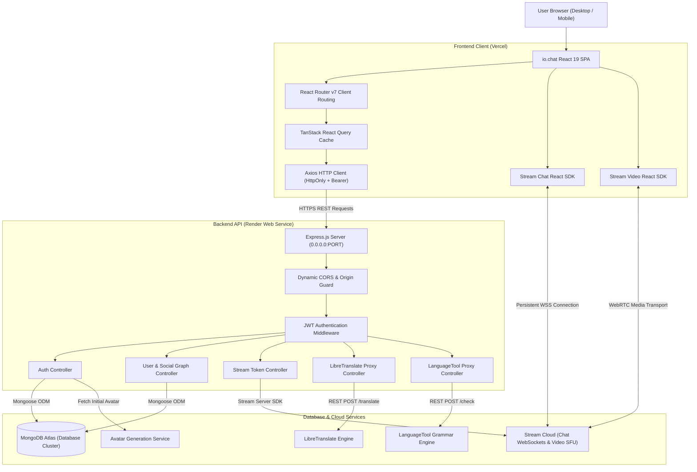
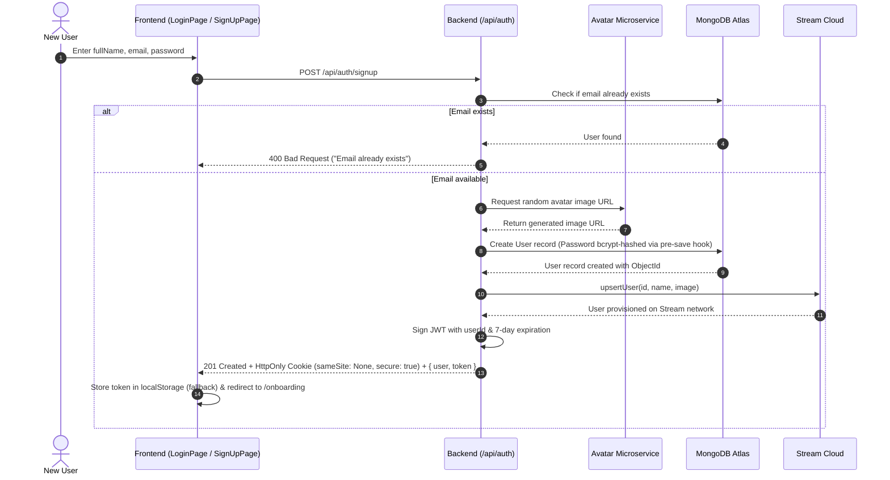
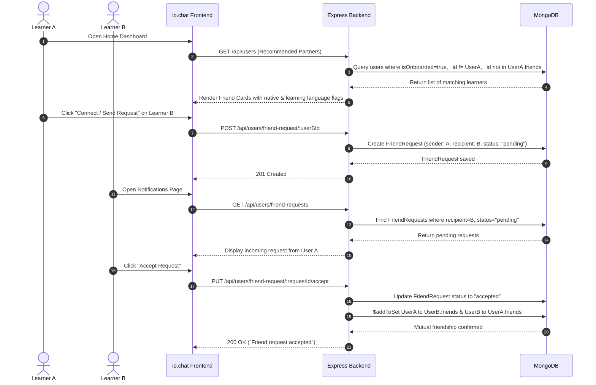
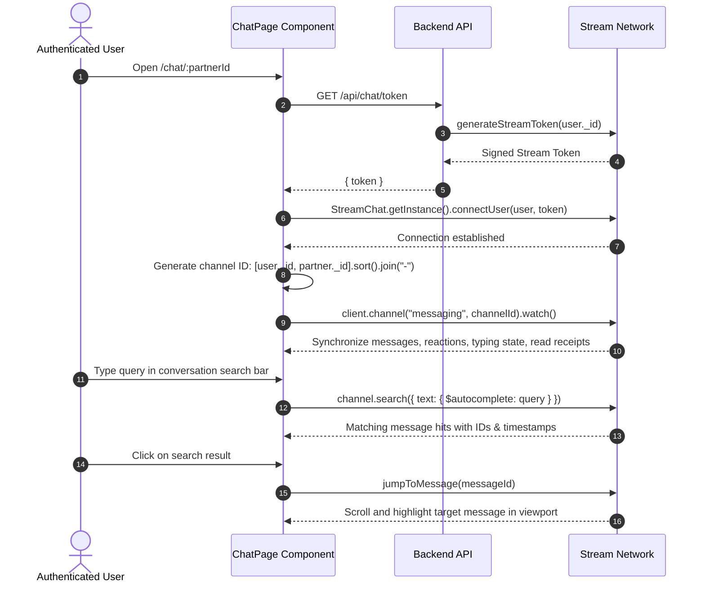
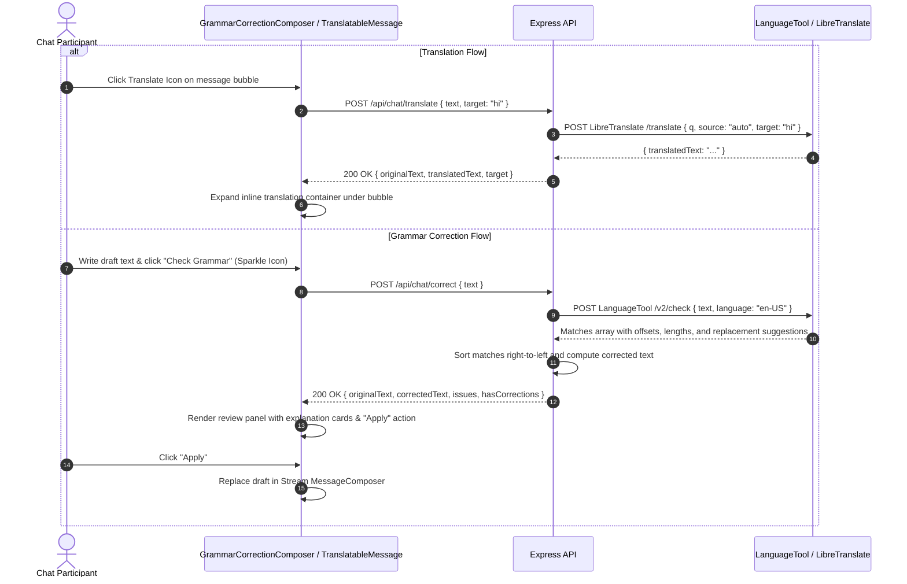
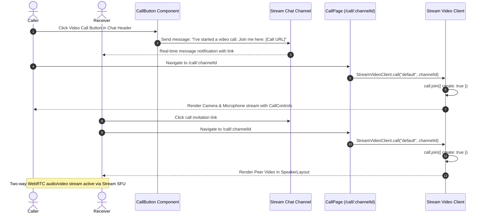

<div align="center">

  <a href="#">
    
  </a>

  <h1>io.chat</h1>

  <p><strong>Real-time language exchange that breaks barriers.</strong></p>

  <p><em>(MERN Stack · Stream Chat & Video · LibreTranslate & LanguageTool)</em></p>

  <p>
    Full-stack real-time communication platform for language learners. Connect with global peers, chat with instant inline translation, polish your messages with AI grammar assistance, and launch HD WebRTC video calls directly in the browser.
  </p>

  <p>
    <a href="#"></a>
    <a href="#"></a>
    <a href="#"></a>
    <a href="#"></a>
    <a href="#"></a>
  </p>

  <p>
    <a href="#quick-start">Quick start</a> ·
    <a href="#features">Features</a> ·
    <a href="#how-it-works">How it works</a> ·
    <a href="#system-architecture">Architecture</a> ·
    <a href="#installation">Install</a> ·
    <a href="#configuration">Configuration</a> ·
    <a href="#security">Security</a>
  </p>

</div>

---

> **Security & Privacy Notice:** This documentation contains zero private secrets, API keys, database credentials, or sensitive user records. All configurations use generic placeholders (e.g., `<your-secret-key>`).

---

<a id="quick-start"></a>
## 1. Quick Start & Executive Summary

**io.chat** is a real-time language learning and cross-border communication platform. It bridges language barriers by pairing learners worldwide for synchronous conversation while augmenting communication through integrated AI translation, real-time grammar assistance, and high-definition WebRTC video calling.

---

<a id="system-architecture"></a>
## 2. System Architecture

The application is engineered as a decoupled modern web stack comprising a Single Page Application (SPA) frontend, an asynchronous Node.js/Express backend API, and third-party cloud infrastructure for real-time WebRTC and chat synchronization.



---

<a id="how-it-works"></a>
## 3. How It Works: End-to-End System Workflows

### 3.1. User Registration & Authentication Workflow



### 3.2. Social Discovery & Mutual Friendship Workflow



### 3.3. Real-Time Chat & Search Workflow



### 3.4. In-Chat Translation & AI Grammar Correction Workflow



### 3.5. WebRTC Video Calling Workflow



---

<a id="features"></a>
## 4. Features & Capabilities Matrix

| Category | Feature | Description | Implementation Details |
| :--- | :--- | :--- | :--- |
| **Auth & Security** | JWT Authentication | Dual-transport session authorization | HttpOnly cookies (`sameSite: "none"`, `secure: true`) + `Authorization: Bearer` fallback |
| | Password Protection | Salted password hashing | `bcryptjs` with salt round 10 via Mongoose pre-save hook |
| | Dynamic CORS Guard | Zero-leak cross-origin security | Restricts access to configured origins and dynamic `*.vercel.app` domains |
| | Automated Avatars | Instant visual user profile setup | Generates unique avatars on signup via external microservice |
| **Social Graph** | Smart Matching | Language exchange partner finder | Filters by onboarding completion and excludes existing connections |
| | Mutual Friendship | Two-way handshake connection | Mongoose `$addToSet` prevents duplicate links; tracks pending states |
| | Request Management | Incoming/outgoing notification tray | Real-time pending counters and accept/decline triggers |
| **Messaging** | Real-Time Sync | Sub-second message delivery | Stream Chat WebSockets with typing indicators, reactions, and read status |
| | In-Chat Search | Instant message lookup and scroll | Full-text search with `jumpToMessage` automatic scroll centering |
| | File Attachments | Multimedia message support | Upload images, videos, and documents with auto-resizing CSS rules |
| **AI & Linguistics** | Live Translation | Multi-language message translation | Backend proxy to LibreTranslate with URL sanitation and timeout aborts |
| | Grammar Assistant | In-composer spelling & syntax polish | LanguageTool API integration with right-to-left character offset replacement |
| **Video Calling** | WebRTC Video | HD video meetings directly in browser | `@stream-io/video-react-sdk` with camera, mic, and speaker layout toggles |
| | Instant Invites | One-click meeting access | Automated invite link generation broadcasted directly to active chat |
| **Personalization**| 32 UI Themes | Instant aesthetic customization | DaisyUI theme engine persisted via Zustand store in `localStorage` |
| | Brand Identity | Distinctive visual language | Custom SVG squircle badge with geometric `io` nodes inside speech silhouette |

---

## 5. Database Schema & Data Models

### 5.1. User Model (`backend/src/models/User.js`)

Represents registered accounts, language profiles, and social relationships.

| Field | Type | Validation / Defaults | Purpose |
| :--- | :--- | :--- | :--- |
| `_id` | `ObjectId` | Auto-generated | Unique record identifier |
| `fullName` | `String` | `required: true` | User's public display name |
| `email` | `String` | `required: true`, `unique: true` | Account login and identification |
| `password` | `String` | `required: true`, `minlength: 6` | Bcrypt-hashed password digest |
| `profilePic` | `String` | `default: ""` | Image URL for avatar display |
| `bio` | `String` | `default: ""` | Self-written user introduction |
| `nativeLanguage` | `String` | `default: ""` | Language the user is fluent in |
| `learningLanguage` | `String` | `default: ""` | Language the user wants to practice |
| `location` | `String` | `default: ""` | Country / City of residence |
| `isOnboarded` | `Boolean` | `default: false` | Gates access to dashboard until profile setup |
| `friends` | `[ObjectId]` | `ref: "User"` | Array of mutually connected partner user IDs |
| `createdAt` | `Date` | Managed by Mongoose | Account creation timestamp |
| `updatedAt` | `Date` | Managed by Mongoose | Last profile update timestamp |

### 5.2. FriendRequest Model (`backend/src/models/FriendRequest.js`)

Tracks invitation states between learners.

| Field | Type | Validation / Defaults | Purpose |
| :--- | :--- | :--- | :--- |
| `_id` | `ObjectId` | Auto-generated | Unique request identifier |
| `sender` | `ObjectId` | `required: true`, `ref: "User"` | User who initiated the connection |
| `recipient` | `ObjectId` | `required: true`, `ref: "User"` | Target user receiving the request |
| `status` | `String` | `enum: ["pending", "accepted"]`, `default: "pending"` | Connection lifecycle state |
| `createdAt` | `Date` | Managed by Mongoose | Request timestamp |
| `updatedAt` | `Date` | Managed by Mongoose | Request resolution timestamp |

---

## 6. API Endpoint Matrix

> **Dual Route Mounting:** All routes respond equally to `/api/<route>` and `/<route>` (e.g., both `/api/auth/login` and `/auth/login` are valid), preventing 404 errors regardless of frontend base URL configuration.

### 6.1. Authentication Routes
- `POST /api/auth/signup` — Registers new account, generates avatar, provisions Stream user, issues JWT.
- `POST /api/auth/login` — Authenticates credentials, issues JWT cookie and body token.
- `POST /api/auth/logout` — Invalidates session cookie with matching cross-site options.
- `POST /api/auth/onboarding` — Updates language targets, bio, and sets `isOnboarded: true`.
- `GET /api/auth/me` — Returns current authenticated user record (`protectRoute` required).

### 6.2. User & Friendship Routes
- `GET /api/users` — Returns recommended partners matching language exchange criteria.
- `GET /api/users/friends` — Returns populated array of confirmed friends.
- `POST /api/users/friend-request/:id` — Sends connection request to recipient ID.
- `PUT /api/users/friend-request/:id/accept` — Confirms request, links users mutually.
- `GET /api/users/friend-requests` — Returns incoming pending requests and recent accepted requests.
- `GET /api/users/outgoing-friend-requests` — Returns pending requests sent by user.

### 6.3. Chat, Video & AI Services Routes
- `GET /api/chat/token` — Generates a cryptographically signed user token for Stream Chat & Video.
- `POST /api/chat/translate` — Proxies text to translation microservice.
- `POST /api/chat/correct` — Analyzes English text via LanguageTool API, returns suggestions.
- `GET /api/health` — Returns `{ status: "ok" }` for Render and external uptime probes.

---

<a id="security"></a>
## 7. Security, Privacy & Error Handling Protocols

1. **Zero Secret Leakage:**
   - Production secrets (`JWT_SECRET_KEY`, `STREAM_API_SECRET`, `MONGO_URI`) are strictly loaded via environment variables and never logged or serialized to client responses.
2. **Cross-Site Cookie Protection:**
   - In production, JWT cookies specify `sameSite: "none"` and `secure: true`.
   - In local development, cookies automatically downgrade to `sameSite: "lax"` and `secure: false`.
3. **CORS Whitelisting:**
   - Dynamic regex validation ensures only sanctioned local hosts, explicit `CLIENT_URL`/`FRONTEND_URL` targets, and legitimate `*.vercel.app` domains can initiate cross-origin requests.
4. **Input Boundaries:**
   - Translation and grammar correction controllers enforce a strict 5,000-character ceiling to prevent buffer exhaustion and third-party rate-limit penalties.
5. **Database Safety:**
   - Mongoose schemas sanitize inputs and enforce strict type checking and enumeration guards.

---

<a id="installation"></a>
<a id="configuration"></a>
## 8. Deployment & Environment Specifications (Vercel & Render)

### 8.1. Backend Service Configuration (Render)
- **Environment:** Node.js
- **Root Directory:** `backend` (or repository root)
- **Build Command:** `npm install`
- **Start Command:** `npm start`
- **Port Binding:** Code binds explicitly to `0.0.0.0` and listens to `process.env.PORT`.
- **Environment Variables Required:**
  ```env
  NODE_ENV=production
  MONGO_URI=<your-mongodb-atlas-connection-string>
  JWT_SECRET_KEY=<your-cryptographic-jwt-secret>
  STREAM_API_KEY=<your-stream-public-key>
  STREAM_API_SECRET=<your-stream-private-secret>
  CLIENT_URL=<your-vercel-domain-without-trailing-slash>
  FRONTEND_URL=<your-vercel-domain-without-trailing-slash>
  LIBRETRANSLATE_URL=https://streamify-libretranslate-2.onrender.com
  ```

### 8.2. Frontend Application Configuration (Vercel)
- **Framework Preset:** `Vite`
- **Root Directory:** `frontend`
- **Build Command:** `npm run build`
- **Output Directory:** `dist`
- **Client Routing Rewrites (`vercel.json`):**
  ```json
  {
    "rewrites": [
      {
        "source": "/((?!api/).*)",
        "destination": "/index.html"
      }
    ]
  }
  ```
- **Environment Variables Required:**
  ```env
  VITE_API_URL=https://<your-render-service-name>.onrender.com/api
  VITE_STREAM_API_KEY=<your-stream-public-key>
  ```
